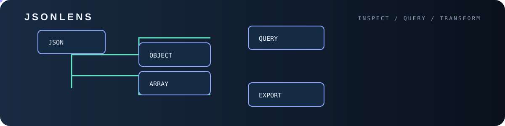
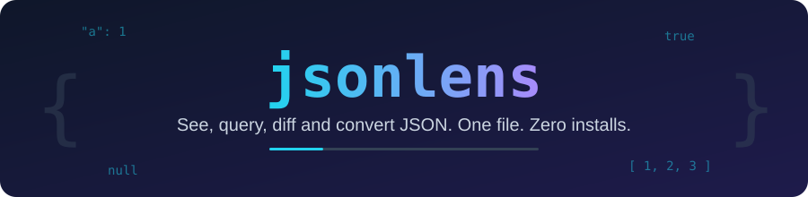

<p align="center">

<p align="center"></p>
  
</p>

<p align="center">
  
  
  
</p>

**jsonlens** is a single Python file that makes JSON easy to read, query, compare and convert.
No `pip install`, no dependencies, no setup. Download one file and run it.

<p align="center">
  
</p>

## Run

```bash
python jsonlens.py view data.json
```

Or grab just the file:

```bash
curl -O https://raw.githubusercontent.com/ERROR404DTIR/jsonlens/main/jsonlens.py
```

Pipe works too: `curl -s https://api.example.com/x | python jsonlens.py view`

## Commands

| Command | What it does |
|---|---|
| `view [file]` | Pretty-print with colors (`-c` to minify, `-i N` for indent) |
| `get file PATH` | Query a path: `users[*].name`, `a.b[0]`, `..id` (recursive), `-r` for raw strings |
| `flat [file]` | Flatten to `path = value` lines |
| `diff a.json b.json` | Structural diff (`+` added, `-` removed, `~` changed). Exit code 1 if different |
| `csv [file] -o out.csv` | Convert an array of objects to CSV (nested keys are flattened) |
| `shape [file]` | Show the structure: keys, types, optional fields (`?`), array item types |

Reads `stdin` when no file is given (or `-`). JSON Lines (`.jsonl`) is detected automatically.
Set `NO_COLOR=1` to disable colors.

## Examples

```bash
python jsonlens.py get users.json "users[*].email" -r
python jsonlens.py get config.json "..port"
python jsonlens.py flat package.json
python jsonlens.py diff old.json new.json && echo "same"
python jsonlens.py csv users.json -o users.csv
python jsonlens.py shape api-response.json
```

## Why

- **One file**, about 300 lines, readable in five minutes
- **Zero dependencies**: only the Python standard library
- **Safe**: read-only, never modifies your files
- Works on Windows, Linux and macOS

## License

MIT